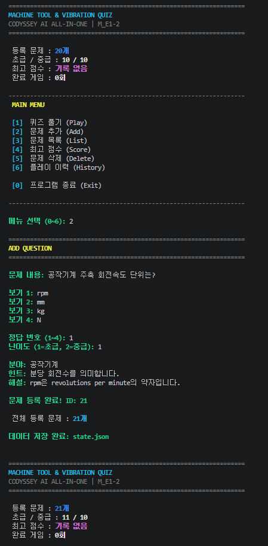
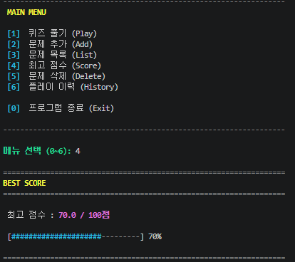
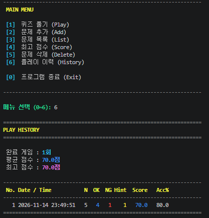
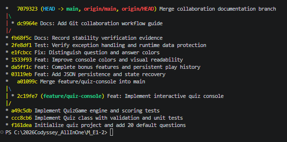

# Machine Tool & Vibration Quiz

## Actual Program Execution - NEITO Criterion #1

**Direct runtime evidence: PASS.**

The following is actual console output captured
by executing the submitted Python application.
It is not a mockup or an expected-output example.

- Execution date: 2026-11-15T00:38:48.172926+09:00
- Python version: 3.12.10
- Operating system: Windows
- Tested source commit: `94dbbe77662abbb1c70f1daaf50eaac157ded41e`
- Execution method: isolated local Git clone
- Keyboard input method: automated standard input

### Actual Main Menu Execution

Executed command:

    python main.py

Actual keyboard input: `0` (Exit)

Captured console output:

    퀴즈 데이터 로드 완료: 20개

    데이터 저장 완료: state.json

    ==================================================================
    MACHINE TOOL & VIBRATION QUIZ
    CODYSSEY AI ALL-IN-ONE | M_E1-2
    ==================================================================

     등록 문제 : 20개
     초급 / 중급 : 10 / 10
     최고 점수 : 기록 없음
     완료 게임 : 0회

    ------------------------------------------------------------------
     MAIN MENU

     [1]  퀴즈 풀기 (Play)
     [2]  문제 추가 (Add)
     [3]  문제 목록 (List)
     [4]  최고 점수 (Score)
     [5]  문제 삭제 (Delete)
     [6]  플레이 이력 (History)

     [0]  프로그램 종료 (Exit)

    ------------------------------------------------------------------

    메뉴 선택 (0~6):
    데이터 저장 완료: state.json

    프로그램을 종료합니다.

**Actual process exit code: 0**

### Actual Runtime Verification

| Verification | Observed result |
|---|---|
| Application startup and main menu | PASS |
| Menu options 0 through 6 | PASS |
| Quiz list | 20 questions |
| Actual quiz gameplay and grading | PASS |
| Best score display | PASS |
| Play history display | PASS |
| Application restart | PASS |
| Persisted best score | 0.0 |
| Persisted play history | 1 |
| Data preserved after restart | PASS |
| Actual application runs | 4 / 4 |
| All process exit codes | 0 |

### Complete Execution Evidence

- [Actual console output for all four runs](docs/ACTUAL_EXECUTION_EVIDENCE.md)
- [Raw actual execution log](logs/R08_actual_execution.txt)
- [Evaluation evidence](docs/EVALUATION_EVIDENCE.md)
- [Main menu screenshot](screenshots/03_Quiz_Main_Menu.png)

The full Markdown evidence includes actual menu,
quiz list, gameplay, score, history and restart output.
ANSI color sequences and trailing whitespace were
removed for readability. Runtime results were preserved.

The original user state.json was not used or modified.

---

CODYSSEY AI ALL-IN-ONE | M_E1-2

공작기계 및 진동 분석 학습용 Python 콘솔 퀴즈

## 1. Project Overview

This project is a Python console-based quiz application
for learning machine tools and vibration analysis.

공작기계 주축, 이송계, 진동 측정, FFT, RMS,
베어링 결함주파수 등 산업현장의 기술 지식을
퀴즈 형태로 학습할 수 있도록 개발하였다.

The project demonstrates Python fundamentals,
object-oriented programming, JSON persistence,
exception handling, automated testing,
and Git collaboration.

## 2. Topic Selection

Machine tools and vibration analysis were selected
to connect Python programming education with
practical manufacturing engineering.

The default questions cover basic machine tool
knowledge and intermediate vibration analysis.

The quiz is an educational tool, not a replacement
for professional machine fault diagnosis.

## 3. Development Environment

| Item | Requirement |
|---|---|
| Operating system | Windows 11 development environment |
| Python | 3.10 or later |
| Editor | Visual Studio Code |
| Version control | Git and GitHub |
| Libraries | Python standard library only |
| Interface | Console / terminal |
| Data format | UTF-8 JSON |

Development environment evidence:

- [Environment screenshot](screenshots/01_Development_Environment.png)
- [Git configuration screenshot](screenshots/02_Git_Configuration.png)
- [Environment execution log](logs/01_development_environment.txt)

## 4. Installation and Execution

Clone the public GitHub repository.

    git clone https://github.com/cody26jade/M_E1-2.git
    cd M_E1-2
    python main.py

No external Python packages are required.

The application loads the default question bank
when state.json does not exist.

## 5. Main Menu

| Menu | Function |
|---|---|
| 1 | Play quiz |
| 2 | Add question |
| 3 | List questions |
| 4 | View best score |
| 5 | Delete question |
| 6 | View play history |
| 0 | Exit |

## 6. Default Question Bank

The application includes 20 original questions.

| Difficulty | Questions |
|---|---:|
| Beginner | 10 |
| Intermediate | 10 |
| Total | 20 |

Each question contains:

- Unique ID
- Difficulty
- Category
- Question text
- Four choices
- Correct answer number
- Hint
- Explanation

Question bank:
[data/default_quizzes.json](data/default_quizzes.json)

## 7. Core Features

### 7.1 Play Quiz

Select the number of questions and answer
using choice numbers 1 through 4.

Questions and choices are randomized.

The application displays correctness,
the correct answer, and an explanation.

### 7.2 Add Question

Enter the question, four choices, answer,
difficulty, category, hint, and explanation.

Input validation is applied before saving.

### 7.3 List Questions

View registered questions and their information.

### 7.4 Best Score

The highest completed game score is retained
and restored when the application restarts.

### 7.5 Exit

The application supports normal exit
and handles interruption and end-of-input.

## 8. Bonus Features

| Feature | Implementation |
|---|---|
| Random questions | Random question selection |
| Question count | User-selected number of questions |
| Hint | H key with score deduction |
| Delete question | Remove a selected question and save |
| Play history | Record completed games |

The order of answer choices is also randomized.
The correct answer index is remapped accordingly.

Q cancels the current game.
Cancelled games are not counted as completed games.

## 9. Scoring System

| Answer result | Points |
|---|---:|
| Correct without hint | 10 |
| Correct with hint | 5 |
| Incorrect | 0 |

Normalized score:

    Score = earned points / maximum points * 100

Accuracy:

    Accuracy = correct answers / question count * 100

For example, four questions with two ordinary
correct answers, one hinted correct answer,
and one incorrect answer produce:

- Earned points: 25 / 40
- Normalized score: 62.5
- Accuracy: 75.0 percent

## 10. Console User Interface

The terminal interface uses ANSI colors,
section separators, and blank lines.

| Display | Color |
|---|---|
| Application title | Cyan |
| Menu and section titles | Yellow |
| Question text | Purple |
| Correct answer feedback | Blue |
| Incorrect answer feedback | Red |
| Hint | Yellow |

The application also supports plain text output
when color output is unavailable or disabled.

## 11. Object-Oriented Design

### Quiz

Implemented in quiz.py.

Responsibilities:

- Store question information
- Validate question data
- Display question information
- Check the selected answer
- Provide hints and explanations
- Shuffle choices and preserve the correct answer
- Convert between objects and dictionaries

### QuizGame

Implemented in quiz_game.py.

Responsibilities:

- Manage the question bank
- Add and remove questions
- Manage game progress
- Calculate scores
- Manage the best score

### QuizStorage

Implemented in storage.py.

Responsibilities:

- Load JSON data
- Save runtime data
- Initialize the default question bank
- Handle invalid or corrupted state data

### Console Application

main.py provides the interactive menu
and connects the application components.

history.py manages play history.
console_ui.py manages terminal presentation.

## 12. Application Architecture

    User
      |
    main.py
      |
    QuizGame ---- Quiz
      |
    QuizStorage
      |
    state.json

Additional modules:

    history.py
    console_ui.py

## 13. JSON Persistence

The runtime file is state.json in the project root.

Its main fields are:

- quizzes
- best_score
- history

The application uses UTF-8 JSON.

Added questions, deleted questions,
best scores, and completed game history
are retained across application restarts.

The default question bank is stored separately
in data/default_quizzes.json.

Runtime data is excluded from Git through
.gitignore to protect local user information.

## 14. Exception Handling

The application handles:

- Empty input
- Invalid menu selection
- Non-numeric input
- Out-of-range answer numbers
- Invalid question data
- Empty question bank
- Missing state file
- Invalid or corrupted JSON
- KeyboardInterrupt
- End-of-input

Recovery and stability tests are included
in the automated test suite.

## 15. Play History

Completed games are recorded with
their time, question count, and score information.

## 16. Automated Testing

Run the complete test suite:

    python -m unittest discover -s tests -v

The final integration test suite contains
148 automated tests.

| Test area | Test file |
|---|---|
| Quiz validation | tests/test_quiz.py |
| Game engine | tests/test_quiz_game.py |
| Console interaction | tests/test_console.py |
| JSON persistence | tests/test_storage.py |
| Bonus features | tests/test_bonus.py |
| Console colors | tests/test_console_ui.py |
| Stability | tests/test_stability.py |
| Integration | tests/test_integration.py |

Actual execution evidence:

[STEP11 Integration Test Log](logs/11_integration_tests.txt)

The integration tests use temporary storage
rather than modifying the user's runtime data.

## 17. Git Version Control

Development uses meaningful Git commits
for individual features, fixes, and tests.

The project includes branch creation,
checkout, merge, push, clone, and pull.

A separate cloned repository was used
to practice a collaboration workflow.

View the Git history:

    git log --oneline --graph --all

- [Collaboration guide](docs/COLLABORATION.md)
- [Remote setup evidence](logs/10B_github_remote.txt)
- [Clone and merge evidence](logs/10C_git_collaboration.txt)
- [Pull verification evidence](logs/10D_git_pull.txt)

## 18. Project Structure

    M_E1-2/
    |-- main.py
    |-- quiz.py
    |-- quiz_game.py
    |-- storage.py
    |-- history.py
    |-- console_ui.py
    |-- data/
    |   `-- default_quizzes.json
    |-- tests/
    |-- logs/
    |-- screenshots/
    |-- docs/
    |   |-- COLLABORATION.md
    |   `-- EVALUATION_EVIDENCE.md
    |-- .gitignore
    |-- .gitattributes
    `-- README.md

state.json is generated during execution
and is not included in the repository.

## 19. Evaluation Evidence

The following document connects implementation,
automated tests, and actual execution logs.

[Complete Evaluation Evidence](docs/EVALUATION_EVIDENCE.md)

Execution logs are retained in the logs directory.

Screenshot evidence is retained in the
screenshots directory.

Screenshots demonstrate actual manual execution.
Automated test results are recorded separately.

## 20. Author

GitHub: [cody26jade](https://github.com/cody26jade)

CODYSSEY AI ALL-IN-ONE

M_E1-2 Python Quiz Project

## 21. Final Reproduction Verification

The published project was cloned into a new
temporary directory on the development computer.

The independent clone was verified against
the original Git commit and tracked Git blobs.

The recorded verification results include:

| Verification | Recorded result |
|---|---|
| GitHub repository visibility | Public |
| Original automated tests | 148 passed |
| Independent clone tests | 148 passed |
| Fresh application startup | Passed |
| Default question initialization | 20 questions |
| Application restart | Passed |
| Runtime data persistence | Passed |
| Original runtime data | Unchanged |

The reproduction test used the same computer
and Python environment as the development project.

It does not establish compatibility with
every operating system or Python version.

Actual execution records:

- [Documentation commit recovery](logs/12ER_commit_recovery.txt)
- [Final reproduction verification](logs/13ABC_final_reproduction.txt)

The recovery record documents the resolution
of a Git whitespace validation failure.

Only document formatting was normalized.
Application source and runtime data were preserved.

## NEITO Revision - Additional Evaluation Evidence

Initial NEITO assessment: 15 of 18 criteria passed.

This revision addresses criteria 13, 15, and 16
and adds explanations for criteria 12 and 14.

### Current Test Status

The original 148 tests are retained.
Eight permission-error tests were added.

- Tests run: 156
- Passed: 156
- Failures: 0
- Errors: 0

Earlier test counts describe historical milestones.

### Criterion 12 - Git Commit Convention

Feat adds functionality, Fix corrects defects,
Docs updates documentation, and Refactor improves
internal structure without intentionally changing
external behavior. Test identifies test changes.

### Criterion 13 - Why Classes Are Used

Quiz encapsulates question data and reusable
validation and answer-checking behavior.

QuizGame abstracts game operations and manages
a collection of Quiz objects independently of
the console user interface.

QuizStorage separates persistence responsibilities.

This separation improves abstraction, encapsulation,
reusability, maintainability, and testability.

The same Quiz class was reused for all 20 default
questions. Serialization and reconstruction were
verified using the existing class implementation.

[Object-oriented design](docs/OBJECT_ORIENTED_DESIGN.md)

### Criterion 14 - Why JSON Is Used

JSON is human-readable and language-independent.
It supports structured data, UTF-8 text, and
standard tools across programming languages.
Python provides built-in JSON support.

### Criterion 15 - File Permission Error Handling

PermissionError is a subclass of OSError.
The application reports save failures and allows
saving to be retried after access is restored.

Temporary-file-based replacement protects the
original state in the tested failure scenarios.

Eight automated tests cover permission errors,
original file preservation, error messages,
retry, and successful reload.

These tests simulate permission errors rather
than modifying actual Windows access permissions.

[File error recovery](docs/FILE_ERROR_RECOVERY.md)

[Permission tests](tests/test_permission_errors.py)

### Criterion 16 - Large-Scale Performance

The actual application was benchmarked using
20, 100, 1000, and 10000 synthetic questions.

| Questions | Initialize (ms) | Save (ms) | Load (ms) | Search (ms) | Memory (MiB) |
|---:|---:|---:|---:|---:|---:|
| 20 | 0.120 | 3.277 | 0.457 | 0.000800 | 0.010 |
| 100 | 0.853 | 4.752 | 2.189 | 0.002300 | 0.040 |
| 1000 | 58.887 | 88.155 | 67.151 | 0.019300 | 0.319 |
| 10000 | 5224.001 | 5125.184 | 5145.996 | 0.181450 | 3.155 |

Total benchmark time: 16.000 seconds.

All four save-and-reload cases passed.

Repeated duplicate validation is a scalability
bottleneck. Initialization and JSON persistence
become slower as the dataset grows.

Linear search is O(N). Dictionary lookup is
expected to be O(1) on average.

Future improvements include dictionary indexing,
normalized question sets, bulk validation,
pagination, and SQLite persistence.

These improvements are proposed, not implemented.

Memory represents traced Python allocations during
Quiz object creation, not total process memory.

[Actual scalability analysis](docs/SCALABILITY_ANALYSIS.md)

[Benchmark source](benchmarks/benchmark_scalability.py)

### Reproduce Additional Tests

Run from the project root:

    python -m unittest discover -s tests -v

    python -m unittest discover -s tests -p test_permission_errors.py -v

    python -u benchmarks/benchmark_scalability.py

The benchmark uses temporary state files and
regenerates the scalability analysis document.

### Actual Revision Execution Records

- [R01 baseline](logs/R01_revision_baseline.txt)
- [R02 class reuse](logs/R02_object_oriented_design.txt)
- [R03 permission tests](logs/R03_permission_errors.txt)
- [R04 performance benchmark](logs/R04_scalability_benchmark.txt)

[Consolidated evaluation evidence](docs/EVALUATION_EVIDENCE.md)

The original application source and runtime
state were preserved during revision tests.

The final NEITO reassessment remains pending.

### Final Revision Verification Record

The recovered revision evidence was validated successfully.

- [R05B final evidence verification](logs/R05B_evaluation_evidence.txt)
