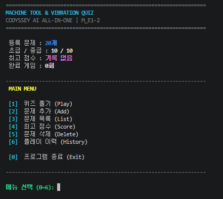
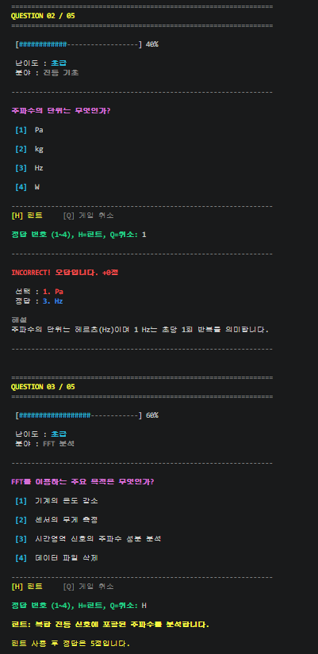
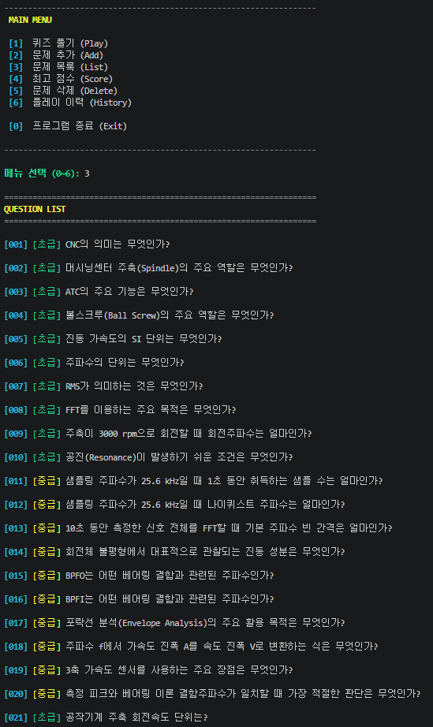
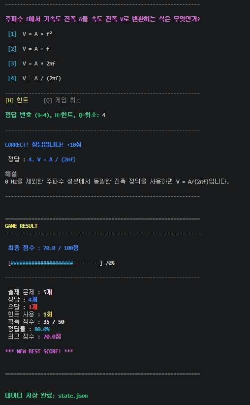

# Machine Tool & Vibration Quiz

CODYSSEY AI ALL-IN-ONE | M_E1-2

공작기계 및 진동 분석 학습용 Python 콘솔 퀴즈

## 1. Project Overview

This project is a Python console-based quiz application
for learning machine tools and vibration analysis.

공작기계 주축, 이송계, 진동 측정, FFT, RMS,
베어링 결함주파수 등 산업현장의 기술 지식을
퀴즈 형태로 학습할 수 있도록 개발하였다.

The project demonstrates Python fundamentals,
object-oriented programming, JSON persistence,
exception handling, automated testing,
and Git collaboration.

## 2. Topic Selection

Machine tools and vibration analysis were selected
to connect Python programming education with
practical manufacturing engineering.

The default questions cover basic machine tool
knowledge and intermediate vibration analysis.

The quiz is an educational tool, not a replacement
for professional machine fault diagnosis.

## 3. Development Environment

| Item | Requirement |
|---|---|
| Operating system | Windows 11 development environment |
| Python | 3.10 or later |
| Editor | Visual Studio Code |
| Version control | Git and GitHub |
| Libraries | Python standard library only |
| Interface | Console / terminal |
| Data format | UTF-8 JSON |

Development environment evidence:

- [Environment screenshot](screenshots/01_Development_Environment.png)
- [Git configuration screenshot](screenshots/02_Git_Configuration.png)
- [Environment execution log](logs/01_development_environment.txt)

## 4. Installation and Execution

Clone the public GitHub repository.

    git clone https://github.com/cody26jade/M_E1-2.git
    cd M_E1-2
    python main.py

No external Python packages are required.

The application loads the default question bank
when state.json does not exist.

## 5. Main Menu

| Menu | Function |
|---|---|
| 1 | Play quiz |
| 2 | Add question |
| 3 | List questions |
| 4 | View best score |
| 5 | Delete question |
| 6 | View play history |
| 0 | Exit |

## 6. Default Question Bank

The application includes 20 original questions.

| Difficulty | Questions |
|---|---:|
| Beginner | 10 |
| Intermediate | 10 |
| Total | 20 |

Each question contains:

- Unique ID
- Difficulty
- Category
- Question text
- Four choices
- Correct answer number
- Hint
- Explanation

Question bank:
[data/default_quizzes.json](data/default_quizzes.json)

## 7. Core Features

### 7.1 Play Quiz

Select the number of questions and answer
using choice numbers 1 through 4.

Questions and choices are randomized.

The application displays correctness,
the correct answer, and an explanation.

### 7.2 Add Question

Enter the question, four choices, answer,
difficulty, category, hint, and explanation.

Input validation is applied before saving.

### 7.3 List Questions

View registered questions and their information.

### 7.4 Best Score

The highest completed game score is retained
and restored when the application restarts.

### 7.5 Exit

The application supports normal exit
and handles interruption and end-of-input.

## 8. Bonus Features

| Feature | Implementation |
|---|---|
| Random questions | Random question selection |
| Question count | User-selected number of questions |
| Hint | H key with score deduction |
| Delete question | Remove a selected question and save |
| Play history | Record completed games |

The order of answer choices is also randomized.
The correct answer index is remapped accordingly.

Q cancels the current game.
Cancelled games are not counted as completed games.

## 9. Scoring System

| Answer result | Points |
|---|---:|
| Correct without hint | 10 |
| Correct with hint | 5 |
| Incorrect | 0 |

Normalized score:

    Score = earned points / maximum points * 100

Accuracy:

    Accuracy = correct answers / question count * 100

For example, four questions with two ordinary
correct answers, one hinted correct answer,
and one incorrect answer produce:

- Earned points: 25 / 40
- Normalized score: 62.5
- Accuracy: 75.0 percent

## 10. Console User Interface

The terminal interface uses ANSI colors,
section separators, and blank lines.

| Display | Color |
|---|---|
| Application title | Cyan |
| Menu and section titles | Yellow |
| Question text | Purple |
| Correct answer feedback | Blue |
| Incorrect answer feedback | Red |
| Hint | Yellow |

The application also supports plain text output
when color output is unavailable or disabled.

## 11. Object-Oriented Design

### Quiz

Implemented in quiz.py.

Responsibilities:

- Store question information
- Validate question data
- Display question information
- Check the selected answer
- Provide hints and explanations
- Shuffle choices and preserve the correct answer
- Convert between objects and dictionaries

### QuizGame

Implemented in quiz_game.py.

Responsibilities:

- Manage the question bank
- Add and remove questions
- Manage game progress
- Calculate scores
- Manage the best score

### QuizStorage

Implemented in storage.py.

Responsibilities:

- Load JSON data
- Save runtime data
- Initialize the default question bank
- Handle invalid or corrupted state data

### Console Application

main.py provides the interactive menu
and connects the application components.

history.py manages play history.
console_ui.py manages terminal presentation.

## 12. Application Architecture

    User
      |
    main.py
      |
    QuizGame ---- Quiz
      |
    QuizStorage
      |
    state.json

Additional modules:

    history.py
    console_ui.py

## 13. JSON Persistence

The runtime file is state.json in the project root.

Its main fields are:

- quizzes
- best_score
- history

The application uses UTF-8 JSON.

Added questions, deleted questions,
best scores, and completed game history
are retained across application restarts.

The default question bank is stored separately
in data/default_quizzes.json.

Runtime data is excluded from Git through
.gitignore to protect local user information.

## 14. Exception Handling

The application handles:

- Empty input
- Invalid menu selection
- Non-numeric input
- Out-of-range answer numbers
- Invalid question data
- Empty question bank
- Missing state file
- Invalid or corrupted JSON
- KeyboardInterrupt
- End-of-input

Recovery and stability tests are included
in the automated test suite.

## 15. Play History

Completed games are recorded with
their time, question count, and score information.

## 16. Automated Testing

Run the complete test suite:

    python -m unittest discover -s tests -v

The final integration test suite contains
148 automated tests.

| Test area | Test file |
|---|---|
| Quiz validation | tests/test_quiz.py |
| Game engine | tests/test_quiz_game.py |
| Console interaction | tests/test_console.py |
| JSON persistence | tests/test_storage.py |
| Bonus features | tests/test_bonus.py |
| Console colors | tests/test_console_ui.py |
| Stability | tests/test_stability.py |
| Integration | tests/test_integration.py |

Actual execution evidence:

[STEP11 Integration Test Log](logs/11_integration_tests.txt)

The integration tests use temporary storage
rather than modifying the user's runtime data.

## 17. Git Version Control

Development uses meaningful Git commits
for individual features, fixes, and tests.

The project includes branch creation,
checkout, merge, push, clone, and pull.

A separate cloned repository was used
to practice a collaboration workflow.

View the Git history:

    git log --oneline --graph --all

- [Collaboration guide](docs/COLLABORATION.md)
- [Remote setup evidence](logs/10B_github_remote.txt)
- [Clone and merge evidence](logs/10C_git_collaboration.txt)
- [Pull verification evidence](logs/10D_git_pull.txt)

## 18. Project Structure

    M_E1-2/
    |-- main.py
    |-- quiz.py
    |-- quiz_game.py
    |-- storage.py
    |-- history.py
    |-- console_ui.py
    |-- data/
    |   `-- default_quizzes.json
    |-- tests/
    |-- logs/
    |-- screenshots/
    |-- docs/
    |   |-- COLLABORATION.md
    |   `-- EVALUATION_EVIDENCE.md
    |-- .gitignore
    |-- .gitattributes
    `-- README.md

state.json is generated during execution
and is not included in the repository.

## 19. Evaluation Evidence

The following document connects implementation,
automated tests, and actual execution logs.

[Complete Evaluation Evidence](docs/EVALUATION_EVIDENCE.md)

Execution logs are retained in the logs directory.

Screenshot evidence is retained in the
screenshots directory.

Screenshots demonstrate actual manual execution.
Automated test results are recorded separately.

## 20. Author

GitHub: [cody26jade](https://github.com/cody26jade)

CODYSSEY AI ALL-IN-ONE

M_E1-2 Python Quiz Project
